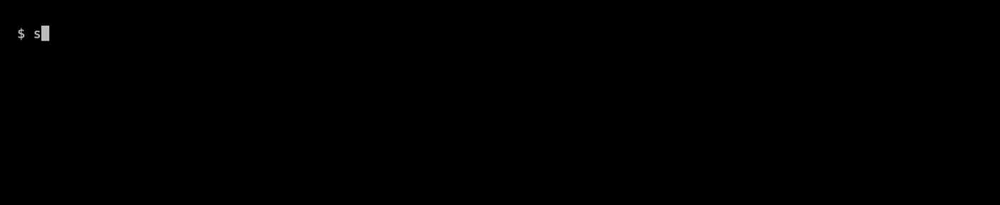

# stury

**stury** is a query engine and a lossless editing tool for jq filters across eleven formats.


## What it does

- **Command line and library:** a command line with jq 1.8.2's answers, and an Odin library that gives the same ones.
- **Queries:** jq's filters, options and exit codes, tested against jq's own test corpus, and builtins jq lacks for
  statistics, sets, pivots, digests, URLs and IP addresses.
- **Conversion:** read any of the formats and write any other. Comments, YAML tags, TOML datetimes, XML attributes and
  CBOR tags are kept wherever the output format can hold them.
- **Lossless edits:** `stury edit` replaces the values a filter changes and copies the rest of the file byte for byte.
  Comments, spacing, key order, quoting and number spellings survive, so a diff of the file shows only the edit.
- **Schema checks:** judge any format against JSON Schema drafts 4 to 2020-12, with the line and column of every
  failure. `check --filter` checks a filter against a schema before any data exists.
- **Schema diff:** compare two versions of a schema and get a proven answer on backward and forward compatibility,
  with a value that breaks it when it does not hold.
- **Speed:** a filter that names a path reads only that path, and a large input is split across cores. On the
  command-line benchmark stury is 2.2 to 290 times faster than jq, jaq, gojq and yq on an Apple M5 Max and an x86-64
  Xeon. The library builds a JSON document faster than yyjson on both, and than simdjson on the M5, within 5% of it on
  the Xeon ([benchmarks](docs/benchmarks.md)).

Formats:

- JSON, JSONC and JSON5
- NDJSON and RFC 7464 JSON sequences
- CSV and TSV
- TOML 1.0 and 1.1
- YAML 1.2
- XML 1.0 with namespaces
- HTML, parsed as browsers parse it
- CBOR and CBOR sequences

## Roadmap

stury is pre-1.0. Options, output and the library API can change in any release. Planned:

- MessagePack, Arrow and Parquet, INI, dotenv and Java properties.
- A C ABI, with bindings for Python (`pystury`), Node, Go and Rust, and a WASM build.
- `schema gen` for TypeScript, Go, Rust and Python, and SQL `CREATE TABLE` as a schema language.
- SARIF and GitHub annotations from `check` and `diff`, a GitHub Action, and schemas picked by file name from
  SchemaStore.
- Globs and directory trees in one run, and gzip input.
- Reading incomplete input, such as JSON streamed from an LLM.

## Install

The command line, on macOS 15 or later, Linux with glibc 2.35 or later, and Windows:

```sh
brew install filip-41/tap/stury     # macOS and Linux, with the manual page
uv tool install stury               # or pipx install stury
uvx stury '.version' package.json   # run it once without installing
```

Each [release](https://github.com/filip-41/stury/releases) also has `stury-VERSION-OS-ARCH.tar.gz` for `darwin` and
`linux` on `amd64` and `arm64`, and `stury-VERSION-windows-amd64.zip`. Each archive holds the binary and the manual page,
`docs/stury.1`. To build from source, use [Odin](https://odin-lang.org/docs/install/) `dev-2026-11` or later:
`make build-cli` writes `build/stury`.

The library needs a 64-bit little-endian target. Clone it into your project and add it as a collection:

```sh
git clone https://github.com/filip-41/stury vendor/stury
odin build . -collection:stury=vendor/stury -o:speed
```

Each format is a package: `stury:json`, `stury:dsv` (CSV and TSV), `stury:toml`, `stury:yaml`, `stury:xml`,
`stury:html`, `stury:cbor`. Models are in `stury:core/model`, and schema inference, sampling and comparison in
`stury:core/schema`.

## Command line

`stury` takes jq's arguments. `--from` and `--to` pick the formats, and without `--from` the file extension does.
Input is strict: `NaN`, `01` and invalid UTF-8 are errors at their line and column. The other differences from jq
are in [docs/cli.md](docs/cli.md#differences-from-jq), which documents every option. Each row below opens on a demo.
The input files are in [docs/demo/files](docs/demo/files).

<details open>
<summary><b>Formats and facts</b></summary>

A CSV record is an object keyed by the header. An XML or HTML element is a member, its text is its value, and a
repeated child is an array. What a format stores next to a value is a fact: `.@comment`, `.@tag` (a TOML or YAML
type, a CBOR tag), `.@anchor`, `.&href` (an attribute), `.@namespace`. `--attributes` reads attributes as `@name`
members instead. `css(selector)` selects XML and HTML elements.


<details>
<summary>As text</summary>

```sh
$ stury --to csv 'select(.country == "NO") | {city, population}' cities.csv
city,population
Oslo,709000
Bergen,286000
$ stury -c '.server | {port, type: (.started | .@tag)}' server.toml
{"port":8080,"type":"datetime"}
$ stury --to yaml . server.toml
server:
  host: a.example # primary
  port: 8080
  started: !!timestamp 2026-11-12T09:00:00Z
$ stury -c '.feed.entry | {id: .&id, ns: .@namespace, title}' feed.xml
{"id":"7","ns":"http://www.w3.org/2005/Atom","title":"Hi"}
$ stury -c '[css("a.story") | .&href]' page.html
["/a","/b"]
```

</details>

</details>

<details>
<summary><b>Edit a file</b></summary>

`stury edit FILTER FILE` writes the file back with only the values the filter changed replaced, and a new value takes
the layout of its container. `--in-place` rewrites the file, `--check` names the files that would change, `--diff`
prints the changes.


<details>
<summary>As text</summary>

```sh
$ cat config.jsonc
{
  // the port the server listens on
  "port": 8080,
  "hosts": ["a", "b"]
}
$ stury edit '.port = 9090 | .hosts += ["c"]' config.jsonc
{
  // the port the server listens on
  "port": 9090,
  "hosts": ["a", "b", "c"]
}
$ stury edit '(css("a.ad") | .&href) = "/sale"' page.html
<!doctype html>
<title>News</title>
<ul>
  <li><a class="story" href="/a">First</a>
  <li><a class="story" href="/b">Second</a>
  <li><a class="ad" href="/sale">Buy</a>
</ul>
$ stury edit --diff '.replicas = 5' deploy.yaml
--- deploy.yaml
~ .replicas: 3 -> 5
```

</details>

</details>

<details>
<summary><b>Check against a schema</b></summary>

`check --schema S` prints every failure with its line, column, path and keyword. `--report basic` prints JSON
Schema's basic output, `--report problem` an RFC 9457 problem document. `check --filter F --schema S` reads no input:
it rejects a member the schema does not allow and prints the schema of the filter's output. `schema infer` writes a
schema from data, `schema sample` writes data that passes a schema (or fails it, with `--invalid`), and `schema gen`
writes Odin types with the schema's rules as tags.


<details>
<summary>As text</summary>

```sh
$ stury check --schema user.schema.json users.ndjson
users.ndjson:2:10: String is too short, at least 2 characters at .name (.properties.name.minLength)
users.ndjson:2:22: Number is below the minimum, at least 0 at .age (.properties.age.minimum)
users.ndjson:3:1: Required member "name" is missing (.required)
users.ndjson:3:9: Value is not of the allowed type, expected integer at .age (.properties.age.type)
$ stury check -c --filter '.nmae' --schema user.schema.json
stury: error: "nmae" is not a member of the object the schema describes (did you mean "name"?) at <top-level>, line 1, column 2:
    .nmae
     ^^^^
{"$schema":"https://json-schema.org/draft/2020-12/schema","type":"null"}
$ stury schema sample --count 2 --seed 1 user.schema.json
{"name":"fc"}
{"name":"he"}
$ stury schema gen user.schema.json | sed -n '/^Root/,/^}/p'
Root :: struct {
	name: string `model:"len>=2"`,
	age: Maybe(i64) `json:",omitempty" model:"optional,not_null,>=0"`,
}
```

</details>

</details>

<details>
<summary><b>Compare files and schemas</b></summary>

`stury diff A B` prints what changed between two files, of the same format or not. With `--old-schema` and
`--new-schema` it compares two schemas: `backward` says whether the new one accepts everything the old one did, and
`forward` the reverse. Each answer is `yes` with a proof, `no` with a value that shows it, or `unknown` with the keyword
where the proof stopped. `--compat backward|forward|full` exits 1 unless that direction is proven.



<details>
<summary>As text</summary>

```sh
$ stury diff old.json new.json
~ .port: 8080 -> 9090
~ .replicas: 3 -> "3"  (number -> string)
+ .tags[1]: "y"
- .debug: true
$ stury diff --old-schema v1.schema.json --new-schema v2.schema.json
.id  minimum: 0 -> 1  narrows
backward: no, {"id":0} passes the old schema and fails the new one
forward: yes
```

</details>

</details>

<details>
<summary><b>Builtins beyond jq</b></summary>

Statistics, set operations, `pivot` and `melt`, digests and HMACs, UUIDs, URL, query-string and logfmt parsing, IP
addresses and RFC 3339 times. [docs/cli.md](docs/cli.md#builtins-beyond-jq) lists them.


<details>
<summary>As text</summary>

```sh
$ stury -s -c '{p90: quantile(0.9; .ms), paths: frequency(.url | parse_url.path)}' access.ndjson
{"p90":296,"paths":[{"value":"/cart","count":2},{"value":"/home","count":1}]}
$ stury -s -c 'map(select(.ip | ip_in_cidr("10.0.0.0/8"))) | length' access.ndjson
2
```

</details>

</details>

<details>
<summary><b>Format, follow, explain, threads</b></summary>

- `stury fmt` formats or converts files, with `--in-place` and `--check`.
- `--follow FILE` answers each record as it is appended to the file.
- `--explain` prints to stderr how the filter runs: whether it reads only a path or builds each input, on how many
  threads, and the time and memory it took.
- An input of 1 MiB or more is split across cores when the filter takes one record at a time, with the output of a
  serial run. `--threads N` sets the count.

</details>

## Library

Each format package has the same calls, and they return the same error union, so code written for JSON reads YAML or
CSV by changing the format argument. The library starts no threads and keeps no global state.

- `validate` checks a text without allocating.
- `find` and `scan` read one path, or several in one pass, without building a document.
- `unmarshal` reads into Odin structs and `marshal` writes them, with field tags and hooks.
- `build` makes a document whose strings point into the input, and `query` runs a path over it.
- `set` and the other edits change a value and keep every other byte.
- `core/model` puts rules on a struct (bounds, lengths, patterns, defaults, read-only members). A load collects every
  failure, `model.problem` turns them into an RFC 9457 document, and `model.patch` applies a partial update.
- `core/schema` checks, infers, samples and compares JSON Schemas and writes Odin types for them.
- `core/diff` compares two values of any format.
- `stury:host` runs records on a thread pool the caller starts.

### Quick start

[examples/quickstart](examples/quickstart/main.odin). Run it with `odin run examples/quickstart -collection:stury=.`,
or add `-- file.json` to read a file.

<details>
<summary>main.odin</summary>

```odin
package main

import "stury:json"
import "core:fmt"
import "core:mem/virtual"
import "core:os"
import "core:strings"

Person :: struct {
	name: string,
	n:    i64,
}

// A fault or an error renders as `line:col: message`, with the path when it has one.
report :: proc(src: []u8, e: json.Error) {
	b: strings.Builder
	defer strings.builder_destroy(&b)
	json.render(strings.to_writer(&b), src, e)
	fmt.eprintln(strings.to_string(b))
}

main :: proc() {
	src := transmute([]byte)string(`{"name":"ada","n":1}`)
	if len(os.args) > 1 {
		data, rerr := os.read_entire_file(os.args[1], context.allocator)
		if rerr != nil {
			os.print_error(os.stderr, rerr, os.args[1])
			os.exit(1)
		}
		src = data
	}
	if err := run(src); err != nil {
		report(src, err)
		os.exit(1)
	}
}

run :: proc(src: []u8) -> json.Error {
	json.validate(src, .Json) or_return

	// What the read and the write allocate, freed at once.
	arena: virtual.Arena
	virtual.arena_init_growing(&arena) or_return
	defer virtual.arena_destroy(&arena)
	alloc := virtual.arena_allocator(&arena)

	person: Person
	json.unmarshal(src, .Json, &person, allocator = alloc) or_return
	out := json.marshal(person, allocator = alloc) or_return
	fmt.println(string(out)) // {"name":"ada","n":1}
	return nil
}
```

</details>

### Examples

Each snippet runs inside a procedure that returns the format's `Error`.

<details>
<summary>Read one value by path</summary>

```odin
src := transmute([]u8)string(`{"name": "ada", "tags": ["math", "engines"]}`)
second_tag := json.parse_path(".tags[1]") or_return
defer json.destroy(&second_tag)
doc, answer := json.find(src, .Json, second_tag) or_return
defer json.destroy(&doc)
if answer.outcome == .Found {
	fmt.println(string(json.span(&doc, answer.node))) // "engines"
}
```

</details>

<details>
<summary>Change one value and keep every other byte</summary>

```odin
src := transmute([]u8)string(`{"name": "ada",  "tags": ["math"]}`)
name := json.parse_path(".name") or_return
defer json.destroy(&name)
out := json.set(src, .Json, name, "grace") or_return
defer delete(out)
fmt.println(string(out)) // {"name": "grace",  "tags": ["math"]}
```

</details>

<details>
<summary>Change a YAML value and keep its comment</summary>

```odin
src := transmute([]u8)string("replicas: 3 # scaled by hand\nports: [80, 443]\n")
replicas := yaml.parse_path(".replicas") or_return
defer yaml.destroy(&replicas)
out := yaml.set(src, .Yaml_1_2, replicas, 5) or_return
defer delete(out)
fmt.print(string(out)) // replicas: 5 # scaled by hand, then the ports line as it was
```

</details>

<details>
<summary>Read CSV rows into structs</summary>

```odin
City :: struct {
	name:       string `csv:"City"`,
	population: Maybe(i64),
}

src := transmute([]u8)string("City,population\nOslo,709000\nAtlantis,\n")
cities: []City
dsv.unmarshal(src, .Csv, &cities, allocator = context.temp_allocator) or_return
fmt.println(cities[1].name, cities[1].population) // Atlantis nil
```

</details>

<details>
<summary>Load a request body into a model, report failures, patch</summary>

From [examples/model](examples/model/main.odin). `json.checks(.Json)` binds the model to JSON, and `dsv.checks(.Csv)`
would bind it to CSV rows.

```odin
User :: struct {
	id:    i64 `model:"read_only"`,
	name:  string `model:"len>=2"`,
	email: Maybe(string) `model:"optional"`,
	role:  string `model:"optional"`,
	set:   model.Fields_Set,
}

reg: model.Registry
model.register(&reg, User, "role", "member") or_return
m := model.compile(&reg, User, json.checks(.Json)) or_return

// Every failure of a body, collected by the sink, as one RFC 9457 document.
bad: User
sink: typed.Sink
if model.load(&m, transmute([]u8)string(`{"name": "a", "email": 3}`), &bad, &sink) != nil {
	p := model.problem(sink.entries[:], "Invalid body", 422) or_return
	defer model.problem_destroy(p)
	fmt.println(string(json.marshal(p) or_return))
}

user: User
model.load(&m, transmute([]u8)string(`{"name": "ada", "email": "ada@example.org"}`), &user) or_return
user.id = 1
fmt.println(string(model.dump(&m, &user) or_return)) // {"id":1,"name":"ada","email":"ada@example.org","role":"member"}

// A patch changes only the members it holds, and the merged value is checked whole.
model.patch(&m, &user, transmute([]u8)string(`{"email": null, "role": "admin"}`)) or_return
fmt.println(string(model.dump(&m, &user, {exclude_none = true}) or_return)) // {"id":1,"name":"ada","role":"admin"}
```

The refused body prints:

```json
{"title":"Invalid body","status":422,"errors":[{"pointer":"/name","code":"too_short","message":"String is too short, at least 2 characters"},{"pointer":"/email","code":"wrong_kind","message":"Value does not fit the field's type, expected string"}]}
```

</details>

<details>
<summary>Check a text against a JSON Schema</summary>

```odin
schema_text := transmute([]u8)string(`{"properties": {"age": {"type": "integer", "minimum": 0}}}`)
s := json.load_schema(schema_text, .Json) or_return
defer json.destroy(s)
b := json.bind_schema(s, .Json) or_return
defer json.destroy(&b)

src := transmute([]u8)string(`{"age": -1}`)
sink := json.Sink{max_errors = 20}
defer json.destroy(&sink)
if json.check_schema(&b, src, &sink) != nil {
	for e in sink.entries {
		fmt.println(e.start, e.kind) // 8 Below_Minimum
	}
}
```

</details>

<details>
<summary>Compare two schemas, and diff two values</summary>

```odin
v1 := json.load_schema(transmute([]u8)string(`{"properties": {"id": {"minimum": 0}}}`), .Json) or_return
defer json.destroy(v1)
v2 := json.load_schema(transmute([]u8)string(`{"properties": {"id": {"minimum": 1}}}`), .Json) or_return
defer json.destroy(v2)
c := schema.compare(v1.description, v2.description, {as = json.as(.Json)}) or_return
defer schema.comparison_destroy(&c)
fmt.println(c.old_in_new.verdict, c.old_in_new.witness) // No {"id":0}
fmt.println(c.new_in_old.verdict) // Yes

old := json.build(transmute([]u8)string(`{"port": 8080, "tags": ["x"]}`), .Json) or_return
defer json.destroy(&old)
new := json.build(transmute([]u8)string(`{"port": 9090, "tags": ["x", "y"]}`), .Json) or_return
defer json.destroy(&new)
r := diff.values(core.Node_Ref{&old, core.ROOT}, core.Node_Ref{&new, core.ROOT}) or_return
defer diff.result_destroy(&r)
for ch in r.changes {
	fmt.println(ch.op, ch.path) // Changed ["port"], then Added ["tags", 1]
}
```

</details>

The complete programs are in [examples/](examples), and `make test-examples` runs them.

| Program | Shows |
| --- | --- |
| [quickstart](examples/quickstart/main.odin) | validate, `unmarshal`, `marshal`, error rendering |
| [scan](examples/scan/main.odin) | one value, or every value of a path, without a document |
| [roundtrip](examples/roundtrip/main.odin) | building a document and querying it |
| [edit](examples/edit/main.odin) | changing a value in place, several edits in one commit |
| [records](examples/records/main.odin) | NDJSON records from a stream and on threads |
| [jsonc](examples/jsonc/main.odin) | JSON with comments |
| [dsv](examples/dsv/main.odin) | CSV into structs and back, dialects, edits, streaming |
| [crossformat](examples/crossformat/main.odin) | one struct read from CSV and JSON |
| [model](examples/model/main.odin) | a model's load, problem document, patch and dump |

## Documentation

| Page | Covers |
| --- | --- |
| [docs/guide.md](docs/guide.md) | the library's packages and calls, by task and by format |
| [docs/cli.md](docs/cli.md) | the command line options, subcommands, formats, and differences from jq |
| [docs/stury.1](docs/stury.1) | the manual page |
| [docs/benchmarks.md](docs/benchmarks.md) | what each benchmark measures, and its figures |
| [bench/README.md](bench/README.md) | how to run the benchmarks and add to them |

### Internals

| Page | Covers |
| --- | --- |
| [docs/walk.md](docs/walk.md) | the walk every read is built on, and the JSON, CSV, TOML and YAML walks |
| [docs/kernel.md](docs/kernel.md) | the SIMD kernels and CPU tiers |
| [docs/document.md](docs/document.md) | the document a build makes, and its readers |
| [docs/edits.md](docs/edits.md) | edit lists and the commit that writes them |
| [docs/paths.md](docs/paths.md) | path queries without a document |
| [docs/typed.md](docs/typed.md) | `unmarshal` and the typed read during the walk |
| [docs/writer.md](docs/writer.md) | the writers and `marshal` |
| [docs/records.md](docs/records.md) | reading a text one record at a time |
| [docs/markup.md](docs/markup.md) | XML and HTML |
| [docs/binary.md](docs/binary.md) | CBOR |

## Development

`ODIN` names the compiler when it is not on `PATH`. `tools/tests` and `bench` are [uv](https://docs.astral.sh/uv/)
projects. `make help` lists every target.

```sh
make build-cli      # build/stury
make check          # the checks the changed files reach
make gate           # everything a branch passes before it lands
make test           # library suites, examples, CLI cases, jq's corpus
make test-lib       # library suites (make test-one P=json/test T=name for one test)
make test-examples  # the example programs against their expected output
make test-py        # all of tools/tests against a fresh build/stury, the oracles included
make diff           # build/stury against jq 1.8.2 on PATH
make diff-schema    # the schema check against Python's jsonschema
make diff-model     # model.load's errors against pydantic
make ecma-diff      # core/regex against Node's RegExp
make lint           # vet with warnings as errors, import and names checks
make names-write    # regenerate each format's names.odin from tools/names.txt
make test-asan      # the suites under AddressSanitizer
make test-tsan      # the suites under ThreadSanitizer
make bench-doc      # a benchmark lane: doc, paths, typed, records, write, schema, edit, cli
```

pytest's own options go through `uv run --directory tools/tests pytest`, for example `-k NAME`.
[bench/README.md](bench/README.md) describes the benchmark lanes. The GIFs are recorded from `docs/demo/*.tape` with
[vhs](https://github.com/charmbracelet/vhs): `vhs docs/demo/intro.tape` after `make build-cli`.

## License

MIT. See [LICENSE](LICENSE). Third-party notices are in [THIRD_PARTY_NOTICES](THIRD_PARTY_NOTICES).
